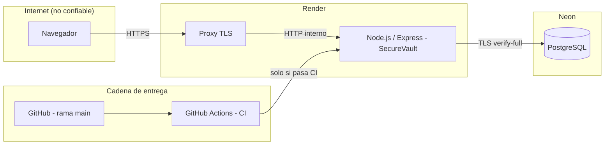

# Modelo de amenazas de SecureVault

Método: STRIDE sobre un diagrama de flujo de datos. Cada amenaza indica la mitigación implementada y dónde está en el código. Lo que no está mitigado se declara como riesgo residual.

## Activos

| Activo | Dónde vive | Protección |
| --- | --- | --- |
| Contraseñas | `users.password_hash` | Hash Argon2id con sal aleatoria |
| Contenido de notas | `notes.content_enc` | AES-256-GCM con AAD = id del dueño |
| Teléfono | `users.phone_enc` | AES-256-GCM con AAD = id del usuario |
| Tokens de recuperación | `password_reset_tokens.token_hash` | Solo hash SHA-256, un uso, 15 minutos |
| Llave de cifrado | Variable `DATA_ENCRYPTION_KEY` | Fuera del código, en el panel de Render y en un gestor de contraseñas |
| Secreto de sesión | Variable `SESSION_SECRET` | Fuera del código |
| Sesiones | Tabla `session` y cookie `sv.sid` | `HttpOnly`, `Secure`, `SameSite=Strict`, 30 minutos |
| Bitácora | `audit_logs` | Sin contraseñas, tokens ni datos cifrados |

## Actores

| Actor | Qué puede hacer |
| --- | --- |
| Usuario legítimo | Gestionar sus propias notas y su perfil |
| Administrador | Ver usuarios, cambiar roles y leer la bitácora; no puede leer notas ajenas |
| Atacante externo no autenticado | Enviar peticiones a la URL pública |
| Usuario autenticado malicioso | Tener una sesión válida e intentar acceder a datos o funciones ajenas |
| Atacante con acceso a la base de datos | Leer o modificar filas si obtiene las credenciales de Neon |

## Diagrama de flujo de datos

Límites de confianza: entre Internet y Render (todo lo que llega del navegador se valida), entre Render y Neon (conexión cifrada y verificada) y en la cadena de entrega (solo llega a producción el código de `main` que pasó el pipeline).

## STRIDE

| Amenaza | STRIDE | Ejemplo en SecureVault | Mitigación implementada | Archivo |
| --- | --- | --- | --- | --- |
| Fuerza bruta de contraseñas | S | Probar miles de contraseñas contra `/api/auth/login` | Rate limit de 5 fallos por IP en 15 minutos (429) y bloqueo de la cuenta 15 minutos tras 5 fallos | `src/routes/auth.js` |
| Robo de sesión | S | Leer la cookie con un script inyectado o enviarla desde otro sitio | Cookie `HttpOnly`, `Secure` y `SameSite=Strict`; ID de sesión regenerado al iniciar sesión; sesiones cerradas al cambiar contraseña o rol | `src/session.js`, `src/routes/auth.js`, `src/routes/admin.js` |
| Manipulación del cifrado | T | Cambiar bytes de `content_enc` en la BD | El tag GCM de 16 bytes detecta cualquier cambio; el descifrado falla y responde 500 genérico | `src/security/crypto.js` |
| Mover datos cifrados entre cuentas | T | Copiar el `content_enc` de una nota de Ana a una nota de Luis | El AAD liga el cifrado al id del dueño; el descifrado falla y se registra `decrypt_failed` | `src/security/crypto.js`, `src/routes/notes.js` |
| Negar un cambio de rol | R | Un administrador niega haber promovido a un usuario | Evento `role_changed` con id del admin, usuario afectado, rol anterior y nuevo, IP y fecha | `src/routes/admin.js`, `src/audit.js` |
| Negar intentos de acceso | R | Un usuario niega haber intentado leer notas ajenas | Eventos `access_denied`, `login_failed` y `login_success` con usuario, IP y fecha | `src/audit.js`, `src/middleware/auth.js`, `src/routes/notes.js` |
| IDOR | I | Pedir `GET /api/notes/:id` con el id de una nota ajena | Toda consulta filtra por `owner_id` de la sesión; responde 404 para no confirmar que la nota existe | `src/routes/notes.js` |
| XSS | I | Crear una nota con título `` | El frontend usa solo `textContent`; la CSP de `helmet` bloquea scripts inline como segunda capa | `public/js/`, `src/app.js` |
| Robo de la base de datos | I | Obtener un respaldo de la BD | Contraseñas con Argon2id, notas y teléfono con AES-256-GCM, tokens solo como hash | `src/security/` |
| Enumeración de usuarios | I | Ver si un correo existe por el mensaje o el tiempo de respuesta | Mensajes genéricos en login, registro y recuperación; hash señuelo para igualar tiempos | `src/routes/auth.js`, `src/security/password.js` |
| Cuerpos enormes | D | Enviar JSON de varios MB | Límite de 10 KB en el cuerpo (413) y límites de tamaño en notas | `src/app.js`, `src/validation/notes.js` |
| Agotar recursos | D | Crear notas sin fin o abusar de registro y recuperación | Máximo 100 notas por usuario; rate limit en registro, recuperación y restablecimiento; timeouts de conexión y de consulta en la BD | `src/routes/notes.js`, `src/routes/auth.js`, `src/db.js` |
| Registrarse como admin | E | Enviar `"role": "admin"` en el registro | `zod` con `.strict()` rechaza el campo (400); el rol siempre se asigna `user` en el servidor | `src/validation/auth.js`, `src/routes/auth.js` |
| Entrar al panel sin permiso | E | Un usuario normal llama a `/api/admin/users` | `requireRole('admin')` consulta el rol en la BD en cada petición (403) y registra `access_denied`; un admin no puede cambiar su propio rol | `src/middleware/auth.js`, `src/routes/admin.js` |

## Casos de abuso

| Como atacante intento... | El sistema responde... |
| --- | --- |
| Adivinar la contraseña de Ana con 7 intentos seguidos | Los 5 primeros: 401 "Credenciales inválidas". Desde el sexto: 429. La cuenta queda bloqueada 15 minutos y se registra una alerta. |
| Registrarme enviando `"role": "admin"` | 400 "Datos de entrada inválidos". |
| Leer, editar o borrar la nota de otro usuario con su id | 404 "No encontrado" en las tres operaciones, y `access_denied` en la bitácora. |
| Entrar a `/api/admin/users` con una cuenta normal | 403 "Acceso denegado", y `access_denied` en la bitácora. |
| Inyectar `` en una nota | 201 al guardarla; al mostrarla se ve como texto y no se ejecuta. |
| Reutilizar un token de recuperación ya usado | 400 "Token inválido o expirado". |
| Enviar un cuerpo JSON de más de 10 KB | 413 "Solicitud inválida". |
| Copiar en la BD el cifrado de una nota ajena a una nota mía | 500 "Error interno" al leerla, y `decrypt_failed` en la bitácora. |

## Análisis de la llave de cifrado

**Si se pierde `DATA_ENCRYPTION_KEY`**, el contenido de las notas y los teléfonos queda irrecuperable: AES-256-GCM no tiene puerta trasera. Las cuentas siguen funcionando, porque las contraseñas usan Argon2id y no dependen de esa llave. Por eso la llave de producción se respalda en un gestor de contraseñas, fuera del servidor y del repositorio.

**Cómo rotarla sin perder datos**, con el diseño actual:

1. Generar una llave nueva y configurarla como `DATA_ENCRYPTION_KEY_V2`, sin quitar la v1.
2. `src/security/crypto.js` usa automáticamente la versión más alta para cifrar todo lo nuevo (prefijo `v2.`).
3. Los datos existentes siguen legibles: el prefijo `v1.` de cada valor indica con qué llave descifrarlo.
4. Un script de re-cifrado recorre las notas y los teléfonos, descifra cada valor con su versión y lo vuelve a cifrar con la v2.
5. Cuando ya no quedan valores `v1.`, se retira la llave v1.

## Riesgos residuales

| Riesgo | Detalle |
| --- | --- |
| Escritura directa en la BD | Un atacante con credenciales de Neon podría reemplazar un `password_hash` o cambiar un rol. La aplicación no lo impide; se reduce con credenciales robustas, TLS y acceso restringido al panel de Neon. |
| Títulos sin cifrar | Solo el contenido de las notas se cifra; los títulos no deben llevar información sensible. |
| Rate limit en memoria | El contador vive en el proceso. Con varias instancias, cada una contaría por separado; con la única instancia del plan gratuito no aplica. |
| Recuperación sin correo | El enlace solo se imprime en la consola de desarrollo; en producción haría falta un proveedor de correo. |
| Sin MFA | La autenticación depende solo de la contraseña. |
| Arranque en frío | El plan gratuito de Render apaga el servicio tras 15 minutos sin tráfico; la primera petición tarda cerca de un minuto. |
